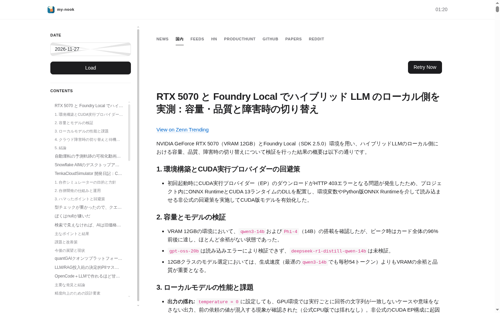

# nook(Cloudflare 版)

技術ニュース、国内の技術記事、論文、OSS の動向を毎朝集めて日本語で要約し、ブラウザで読めるようにする個人用アプリです。記事ごとに AI へ質問もできます。今後は、読んだ内容を自分の知識として定着させる学習支援の機能を足していく予定です([#23](https://github.com/shiyow5/nook/issues/23))。

[discus0434/nook](https://github.com/discus0434/nook) をもとに、AWS を使わず GitHub Actions と Cloudflare の無料枠で動く構成に作り替えています。本家の更新は `upstream` リモートから取り込めます。



## できること

毎朝 6 時過ぎ(日本時間)に GitHub Actions が収集を実行し、記事を Gemini で日本語に要約して Cloudflare R2 に保存します。画面は Cloudflare Workers が R2 から読み出して表示し、Cloudflare Access で本人だけが開けるようにしています。

開くと最初にホームが出ます。記事の読み込みに時間がかかるときは「今日の記事を集めています」と表示し、読み込めなかったときは「もう一度読み込む」ボタンを出します。ホームにはその日のタブ数と記事数、最後に開いた記事(「続きから読む」)、国内・海外・論文から 1 本ずつの「まず読む 3 本」、タブごとの件数と先頭 3 本のカードが並び、上の検索欄ではその日の全タブの記事を題名と出典で探せます。記事やカードを押すと、そのタブの詳細画面(`/read`)に移ります。左上のメニューには、メイン(ホーム)、ジャンル(国内・海外・論文に分類したタブ)、設定が並びます。詳細画面の「☆ 保存」を押した記事は、メニューの「ブックマーク」にまとまります。保存した記事は本文の写しを D1 に残すので、90 日を過ぎても読めます。メニューの「用語辞書」では、学びパネルの用語カードから「＋ 辞書に追加」した語や自分で足した語を、重要の印、理解できたかどうか、頭文字の索引、単語カードで整理できます。説明は AI に下書きさせることもできます。記事の本文で語を選ぶと出るボタンからも、その記事を出典にして登録できます(スマホは長押しで選択)。履歴はまだ作っていないので「準備中」と出しています。日付はカレンダーか前後の矢印で切り替えます。記事に画像があるときは、一覧と本文の上にサムネイルを出します。詳細画面では、左の記事一覧で記事を選ぶと、真ん中に 1 本ずつ表示されます。記事一覧は閉じられ、上の欄でその日の記事を絞り込めます。右下の丸いボタンを押すと「今日の学び」が開きます。表示中の記事に出てきた専門用語とその解説が並び、「理解度チェック」を押すと 4 択の問題が 3 問出ます。その上の吹き出しのボタンは AI チャットで、要点、前提知識、自由な質問に AI が Google 検索で事実を確かめながら答えます。チャットは収集時に読んだ元記事の本文も材料にするので、画面側から読めない Reddit などの記事でも中身に沿って答えます。パネルの「解説」では、入門(3 行まとめ・例え・前提の用語・なぜ大切か)と深掘り(仕組み・実務の良い例と悪い例・注意点)を切り替えて読めます。用語と問題は一度作ると R2 に保存し、同じ記事では作り直しません。いちばん上の鉛筆のボタンは「演習」で、記事の要点を自分の言葉で書いて送ると、AI が記事と見比べて、理解できている点・ずれている点・補足を返します。やり取りは D1 に残り、あとから見返せます。スマホでは記事一覧と本文を切り替えて表示し、学びは画面の下から開きます。記事一覧の「再取得」を押すと、そのタブの収集を GitHub Actions で 1 件だけやり直します。

一度要約した記事やリポジトリは、要約を R2 に保存して使い回します。何日もランキングに残る記事を毎日要約し直さないので、LLM の費用を抑えられます。保存したデータは 90 日たつと自動で消えます。

## タブと情報源

| タブ | collector | 情報源 |
|---|---|---|
| News | `tech_news` | 海外の AI・テック系メディア、OpenAI / AWS のブログ、日経ビジネス・Business Insider Japan・日経クロステック・ITmedia AI+ |
| 国内 | `jp_tech_news` | Zenn(トレンド、LLM、機械学習)、Qiita(人気記事、LLM、機械学習)、note(生成AI、LLM)、はてなブックマーク IT、DevelopersIO |
| Feeds | `tech_feed` | Hugging Face、Google Research、DeepMind のブログ |
| HN | `hacker_news` | Hacker News の上位 30 件 |
| ProductHunt | `product_hunt` | Product Hunt の当日の上位製品(API の鍵を登録すると有効、[#8](https://github.com/shiyow5/nook/issues/8)) |
| GitHub | `github_trending` | GitHub Trending(Python) |
| Papers | `paper_summarizer` | Hugging Face Daily Papers(本文を読んで要約し、論文タイトルの日本語訳も付ける) |
| arXiv | `arxiv_news` | arXiv の cs.CL / cs.LG / cs.AI の新着から、KV キャッシュ・長文脈・推測的デコーディング・MCTS・強化学習などの語に一致した論文(各カテゴリ最大 10 本、Papers タブと重複しない) |
| Reddit | `reddit_explorer` | r/LocalLLaMA |

右上の歯車から開く設定画面では、毎朝収集するタブのオンとオフを切り替えられます。国内、News、arXiv の 3 タブは、フィードの追加と削除、キーワード、1 フィードあたりの件数の上限も画面で変えられ、保存した内容は次回の収集から使われます。設定は R2 に保存し、変えていない部分は `configs/<collector>/feed.toml` の値をそのまま使います。TOML を直接編集してもかまいません。`keywords` を書いたフィードは、タイトルや本文に一致した記事だけを残します。日本語を含む URL はパーセントエンコードして書いてください。

## 構成

```text
GitHub Actions(.github/workflows/collect.yml、毎日 06:17 JST と手動実行)
  └─ Python の collector(nook/services/*)
       ├─ Gemini API で要約(同じ入力は R2 のキャッシュを使う)
       └─ Markdown と状態を R2 に保存(S3 互換 API)

Cloudflare Worker「nook-viewer」(nook/deploy/cloudflare/viewer、TypeScript)
  ├─ Cloudflare Access の JWT を毎回検証
  ├─ R2 から記事を読んで画面を返す
  ├─ /chat/{tab}  : Gemini API に Google 検索付きで質問する
  └─ /retry/{tab} : GitHub Actions の collector を 1 件だけ起動する
```

collector は本家と同じ Python のコードです。保存先を環境変数で R2 に向けているので、本家の AWS 版やローカル版(`make local-register`)もそのまま動きます。

## 導入

GitHub リポジトリ、R2、Worker、Access の作り方は [docs/CLOUDFLARE.md](docs/CLOUDFLARE.md) にまとめています。必要なものは Cloudflare アカウント(R2 の有効化に支払い方法の登録が必要、無料枠内なら請求なし)、Gemini API キー、Reddit API の認証情報です。

GitHub に登録する値は次のとおりです。

| 種類 | 名前 |
|---|---|
| Secrets | `GOOGLE_API_KEY`、`REDDIT_CLIENT_ID`、`REDDIT_CLIENT_SECRET`、`REDDIT_USER_AGENT`、`R2_ACCESS_KEY_ID`、`R2_SECRET_ACCESS_KEY`、`R2_ENDPOINT_URL`、`PRODUCT_HUNT_API_KEY`、`PRODUCT_HUNT_DEVELOPER_TOKEN` |
| Variables | `LLM_MODEL`(例: `google-gla:gemini-flash-lite-latest`)、`R2_BUCKET`、`NOOK_ENABLED_COLLECTORS`(毎朝動かす collector をカンマ区切りで) |

## 開発

```bash
uv sync --dev
make post-change        # ruff format、ruff check、pytest

cd nook/deploy/cloudflare/viewer
npm ci
npm test                # Workers のランタイム上で vitest を実行
npm run typecheck
npm run deploy          # viewer を手元から Cloudflare にデプロイ(普段は不要)
```

viewer は main にマージされると、GitHub Actions の `deploy-viewer` が検査を通してから自動でデプロイします。

収集を手動で動かすときは `gh workflow run collect.yml -f collectors=jp_tech_news` のように collector 名を指定します。

設計の詳細は [docs/DESIGN.md](docs/DESIGN.md) にあります。リポジトリ内で AI エージェントに作業させるときの決まりは [AGENTS.md](AGENTS.md) です。

## 進め方と今後

このリポジトリは Issue 駆動で進めています。不具合、要望、実装予定はすべて [Issues](https://github.com/shiyow5/nook/issues) に登録し、Issue ごとにブランチと Pull Request を作って閉じていきます。

いま予定している主な作業は、画面からキーワードや収集対象を変える設定画面、Gemini の費用削減の検討([#1](https://github.com/shiyow5/nook/issues/1))です。その先に、お気に入り、用語辞書、AI による要約の添削やケーススタディといった学習支援の機能を [#23](https://github.com/shiyow5/nook/issues/23) で計画しています。

## ライセンスとクレジット

このプロジェクトは [discus0434/nook](https://github.com/discus0434/nook) の派生物で、元のプロジェクトと同じ GNU Affero General Public License v3.0 で公開しています。詳細は [LICENSE](LICENSE) を参照してください。不具合や要望は [Issues](https://github.com/shiyow5/nook/issues) へお寄せください。
